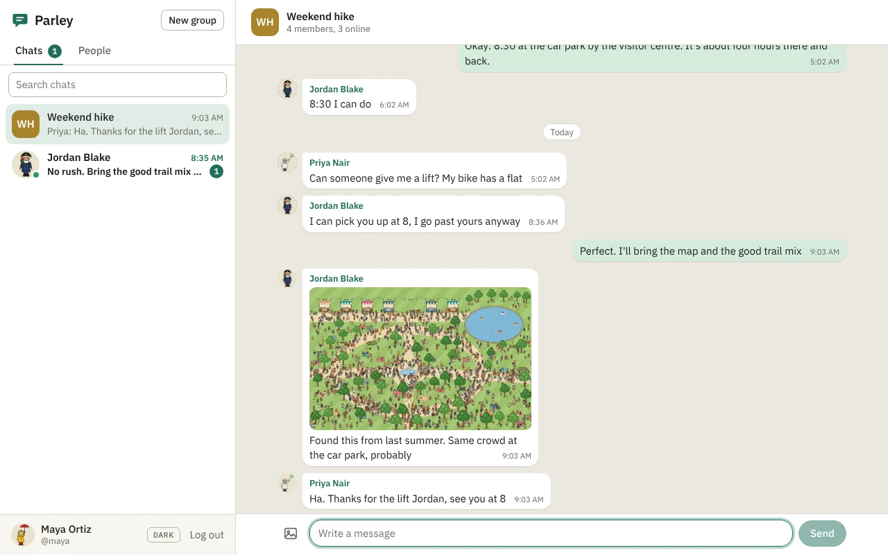

# Parley (Messaging App)

A messaging app built for The Odin Project NodeJS course. Sign up, find people, and talk to them one to one or in groups, with pictures, profiles and a green dot for whoever is online.



Built with Express, PostgreSQL and Prisma. The app itself is plain HTML, CSS and JavaScript, served by the same Express app.

**Live demo:** [parley-chat.onrender.com](https://parley-chat.onrender.com). It runs on Render's free plan, which sleeps when nobody uses it, so the first visit can take up to a minute to load.

## What it does

- **Accounts:** sign up and log in with a username and password.
- **Direct messages:** pick anyone from the People list and start a chat.
- **Group chats:** create a group, rename it, add people or leave. Changes show up in the chat as notes like "Maya added Sam Lee".
- **Pictures:** attach one with the picture button, paste it, or drop it onto the chat. Click a picture to see it large.
- **Profiles:** set your name, a line about yourself and a photo. Click a chat's header, or someone's face in a group, to see their profile.
- **Who's online:** a green dot and "Online", or "Last seen 5 minutes ago".
- **Unread counts:** a badge on each chat and a total in the browser tab's title.
- **Read receipts:** "Seen" appears under your last message once the other person has read it.
- Dark mode, and a layout that works on phones.

## How it works

**New messages without reloading.** A REST API can only answer when it's asked, so the page asks: every 3 seconds it fetches the chat list, and if the open chat has something new it fetches just the messages after the last one it has. A tab in the background slows down to every 30 seconds.

**Logging in.** A successful log-in sets a cookie holding a signed token (a JWT) that lasts 7 days. The cookie is `HttpOnly`, so JavaScript on the page can't read it, and `SameSite=Lax`, so other websites can't use it. The browser sends it with every request, including the ones for pictures, which is what lets pictures stay private.

**Who can see what.** Every route for a chat first checks that you're in it. If you aren't, you get the same "not found" as for a chat that doesn't exist. A picture in a chat can only be opened by the people in that chat.

**Pictures.** They're stored in the database, so the app needs no separate file storage. Before uploading, the browser shrinks big photos to 1600px. The server checks that each upload really is a PNG, JPEG, GIF or WebP by reading it, not by trusting its name.

**Online status.** Each request from the app counts as a check-in, saved at most every 30 seconds. Someone is online if they checked in during the last 90 seconds. Logging out marks you offline straight away.

**Unread counts.** Each member of a chat has a "read up to" marker, the id of the last message they've seen. Anything newer from someone else is unread. The marker moves when you're looking at the bottom of the chat.

**Limits.** 10 wrong passwords per 15 minutes, 20 new accounts per hour and 20 messages per 10 seconds. Messages can be up to 2,000 characters and pictures up to 4 MB.

## Database design

```
User                     Conversation               Member                         Message                    Image
---------------------    -----------------------    ---------------------------    -----------------------    ---------------------
id            PK         id             PK          conversationId   PK, FK        id              PK         id         PK (uuid)
username      unique     isGroup                    userId           PK, FK        conversationId  FK         data       the picture
displayName              name           groups      joinedAt                       senderId        FK         mimeType
about                    directKey      unique      lastReadMessageId              kind            TEXT or    width, height
passwordHash  bcrypt     createdAt                                                                 EVENT      messageId  FK, unique
lastSeenAt               lastMessageAt                                             body                       userId     FK, unique
createdAt                                                                          createdAt                  createdAt
```

- A **Conversation** is either a chat between two people or a group. `directKey` is the two user ids joined together (like `3:7`), which guarantees two people only ever get one chat.
- A **Member** row puts a user in a conversation and remembers how far they've read.
- A **Message** is normal text (`TEXT`) or a note such as "created the group" (`EVENT`).
- An **Image** belongs either to a message (`messageId`) or to a user as their profile photo (`userId`). Deleting the message or the user deletes the picture.

The schema is in [`prisma/schema.prisma`](prisma/schema.prisma).

## API

Every route except sign-up and log-in needs you to be logged in.

| Method | Route | What it does |
|--------|-------|--------------|
| POST | `/api/auth/signup` | `{ username, displayName, password }`. Creates an account and logs in |
| POST | `/api/auth/login` | `{ username, password }` |
| POST | `/api/auth/logout` | Clears the cookie |
| GET | `/api/auth/me` | The logged-in user |
| GET | `/api/users` | Everyone else, with people who are online first |
| GET | `/api/users/:username` | One person's profile |
| PATCH | `/api/users/me` | `{ displayName?, about? }` |
| PUT | `/api/users/me/avatar` | A form with the picture in `avatar` |
| DELETE | `/api/users/me/avatar` | Removes your photo |
| GET | `/api/conversations` | Your chats, newest first, each with its members, last message and unread count |
| POST | `/api/conversations/direct` | `{ userId }`. Opens your chat with someone, creating it the first time |
| POST | `/api/conversations/groups` | `{ name, memberIds }` |
| GET | `/api/conversations/:id` | One chat |
| PATCH | `/api/conversations/:id` | `{ name }`. Renames a group |
| POST | `/api/conversations/:id/members` | `{ userIds }`. Adds people to a group |
| DELETE | `/api/conversations/:id/members/me` | Leaves a group |
| GET | `/api/conversations/:id/messages` | The newest 50. `?before=<id>` for older ones, `?after=<id>` for new ones |
| POST | `/api/conversations/:id/messages` | `{ body }` as JSON, or a form with `body` and a picture in `image` |
| PUT | `/api/conversations/:id/read` | `{ messageId }`. Marks everything up to that message as read |
| GET | `/api/images/:id` | A picture |

Errors come back as JSON with a matching status code. Validation errors list each field:

```json
{
  "error": "Some fields need fixing.",
  "details": [{ "field": "username", "message": "That username is taken." }]
}
```

## Run it locally

You need [Node.js](https://nodejs.org/) and [PostgreSQL](https://www.postgresql.org/download/).

Create a database and user in `psql`. `CREATEDB` lets Prisma make a temporary database while it creates migrations:

```sql
CREATE USER parley_user WITH PASSWORD 'parley_pass' CREATEDB;
CREATE DATABASE messaging_app OWNER parley_user;
```

Then copy `.env.example` to `.env`, set `JWT_SECRET` to a long random string, and run:

```bash
cd "Messaging App"
npm install
npx prisma migrate dev
npm run seed
npm start
```

Open [http://localhost:3000](http://localhost:3000) and sign up.

`npm run seed` is optional. It adds five demo accounts (`maya`, `jordan`, `sam`, `priya` and `tom`) with a few chats between them, so there's someone to talk to. Their password is `SEED_PASSWORD` from `.env`. It never deletes anything, and running it again does nothing.

To try a conversation by yourself, log in as two different people in two browsers, or in one normal window and one private window.
