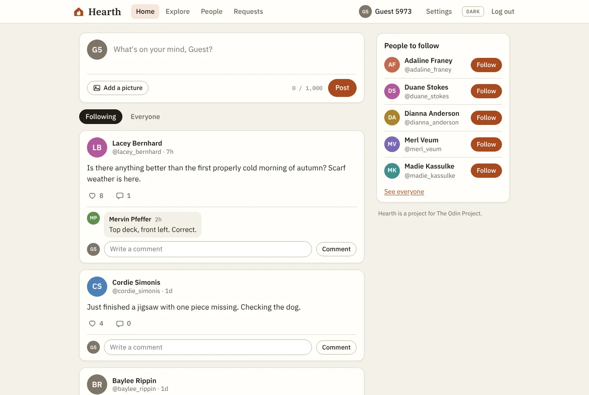

# Hearth (Odin-Book)

A small social network built for The Odin Project NodeJS course. Follow people, post text and pictures, like and comment, and keep up with everyone you follow on your home page.



Built with Express, EJS, Passport, PostgreSQL and Prisma.

## What it does

- **Sign in first:** nothing but the sign-in and sign-up pages can be seen without an account.
- **Guest sign-in:** "Look around as a guest" makes a throwaway account in one click, already following a few people. Guest accounts are removed after a day.
- **Follow requests:** follow someone and they get a request to accept or decline. People who turn off "Approve followers myself" can be followed straight away.
- **Posts:** text, a picture, or both. Web addresses become links.
- **Likes and comments:** every post shows its author, text, likes and comments. The heart updates without reloading the page.
- **Home and Explore:** Home shows recent posts from you and the people you follow. Explore shows everyone's.
- **Profiles:** a photo, name, bio, counts, posts, and lists of followers and following.
- **People:** everyone on the site, with search and a Follow button that shows "Requested" or "Following" once you've used it.
- **Settings:** change your name, bio and photo, and choose whether to approve followers.
- Dark mode, and a layout that works on phones.

## How it works

**Signing in.** Passport's local strategy checks the username and password, and passwords are stored as bcrypt hashes. The session lives in the database (through `connect-pg-simple`), so people stay signed in when the server restarts. The cookie is `HttpOnly` and `SameSite=Lax`, and forms sent from other websites are refused.

**Pages are drawn on the server** with EJS, so the site works even with JavaScript switched off. A small script adds the nicer touches: likes that update in place, a preview of the picture you're about to post, and a character count.

**Following.** A `Follow` row is either `PENDING` (a request) or `ACCEPTED`. Only accepted follows count for your home page and for the follower numbers on a profile.

**Pictures.** They're stored in the database, so the app needs no separate file storage. The browser shrinks big photos to 1600px before uploading, and profile photos are cropped to a square. The server checks that each upload really is a PNG, JPEG, GIF or WebP by reading it, not by trusting its name. Without a photo, people get their initials on a coloured circle.

**Who can change what.** You can delete your own posts and comments, and any comment on your own post. Trying it on someone else's gives the same "not found" as something that doesn't exist.

**Limits.** 10 wrong passwords per 15 minutes, 20 new accounts per hour and 30 posts, likes, comments or follows per 10 seconds. Posts can be up to 1,000 characters, comments 500, and pictures 4 MB.

## Database design

```
User                   Follow                    Post               Like              Comment            Image
-------------------    ----------------------    ---------------    --------------    ---------------    -------------------
id            PK       followerId   PK, FK       id         PK      userId  PK, FK    id         PK      id       PK (uuid)
username      unique   followingId  PK, FK       authorId   FK      postId  PK, FK    postId     FK      data     the picture
displayName            status       PENDING or   body               createdAt         authorId   FK      mimeType
bio                                 ACCEPTED     createdAt                            body               width, height
passwordHash  bcrypt   createdAt                                                      createdAt          postId   FK, unique
requiresApproval                                                                                         userId   FK, unique
isGuest
createdAt
```

- **Follow** joins two users: `followerId` follows, or has asked to follow, `followingId`.
- **Like** joins a user and a post. The pair is the key, so nobody can like a post twice.
- An **Image** belongs either to a post or to a user as their profile photo.
- Deleting a post deletes its likes, comments and picture. Deleting a user deletes everything of theirs.
- A `session` table holds who is signed in.

The schema is in [`prisma/schema.prisma`](prisma/schema.prisma).

## Pages and routes

| Method | Route | What it does |
|--------|-------|--------------|
| GET, POST | `/login`, `/signup` | Sign in, or create an account |
| POST | `/guest` | Sign in as a new guest |
| POST | `/logout` | Sign out |
| GET | `/` | Home: posts from you and the people you follow |
| GET | `/explore` | Posts from everyone |
| POST | `/posts` | Create a post, with an optional picture |
| GET | `/posts/:id` | One post with all its comments |
| POST | `/posts/:id/delete` | Delete your post |
| POST | `/posts/:id/like`, `/unlike` | Like or unlike |
| POST | `/posts/:id/comments` | Comment on a post |
| POST | `/comments/:id/delete` | Delete a comment |
| GET | `/users` | Everyone, with search (`?q=`) |
| GET | `/users/:username` | A profile. Add `/followers` or `/following` for those lists |
| POST | `/users/:username/follow`, `/unfollow` | Follow or send a request; unfollow or cancel one |
| GET | `/requests` | Requests waiting for you, and ones you've sent |
| POST | `/requests/:username/accept`, `/decline` | Answer a request |
| GET | `/settings` | Your settings |
| POST | `/settings/profile`, `/settings/photo`, `/settings/photo/remove` | Change your details or photo |
| GET | `/images/:id` | A picture |

## Run it locally

You need [Node.js](https://nodejs.org/) and [PostgreSQL](https://www.postgresql.org/download/).

Create a database and user in `psql`. `CREATEDB` lets Prisma make a temporary database while it creates migrations:

```sql
CREATE USER hearth_user WITH PASSWORD 'hearth_pass' CREATEDB;
CREATE DATABASE odin_book OWNER hearth_user;
```

Then copy `.env.example` to `.env`, set `SESSION_SECRET` to a long random string, and run:

```bash
cd "Odin Book"
npm install
npx prisma migrate dev
npm run seed
npm start
```

Open [http://localhost:3000](http://localhost:3000) and sign up, or look around as a guest.

`npm run seed` runs [`prisma/seeds.js`](prisma/seeds.js), which uses [Faker](https://fakerjs.dev/) to make 14 sample people with posts, likes, comments and follows. Their password is `SEED_PASSWORD` from `.env`. It never deletes anything, and running it again does nothing.
