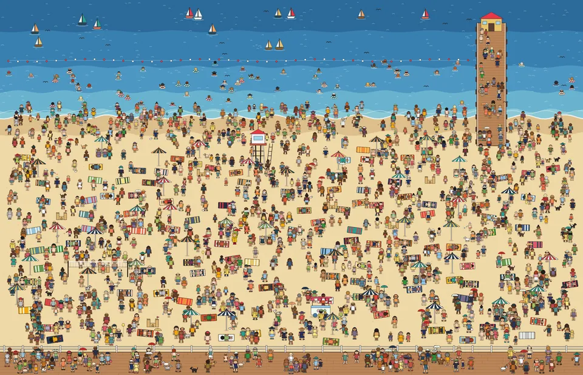

# Where's Mabel? (Photo Tagging App)

A Where's Waldo style game, built for The Odin Project NodeJS course. Mabel, Captain Gull, Professor Fern and Biscuit the dog are hiding in three crowded pictures. Click where you think someone is, pick their name from the list, and find all four as fast as you can. The fastest ten times for each picture go on the high scores.



Built with Express, PostgreSQL and Prisma. The game itself is plain HTML, CSS and JavaScript, served by the same Express app.

## How to play

- Pick a picture: **The Beach**, **Park Fair** or **Winter Market**.
- Click the picture. A targeting box appears with a list of the characters you haven't found yet.
- Choose who you think is in the box. If you're right, they get a marker. If not, keep looking.
- Use **+** and **−** (or the keys) to zoom, and drag with the mouse to look around.
- Find all four and the clock stops. If your time is in the top ten, add your name.

## How it works

**Hiding spots.** Each character's position is stored as a box measured in fractions of the picture's width and height, not in pixels. The browser sends clicks the same way (0.5 means halfway across), so a click lands on the same spot on any screen size and at any zoom.

**Timing happens on the server.** When the picture has loaded, the browser starts a game and the server notes the start time. When the last character is found, the server notes the finish time and works out the score. The clock you see is only for show, so changing it in the browser doesn't change your time.

**Players don't need accounts.** Starting a game returns a long random id. That id is the player's ticket for the round: guesses and the name for the high scores are sent with it.

**Making cheating harder.**
- The browser never gets a character's position until you've found them.
- Guesses less than 300 ms apart are refused, so a script can't click all over the picture.
- A finished game can't be played on, and a name can only be added once, and only to a top-ten time.

Games that never got a name are deleted after a day.

## Database design

```
Scene                    Character               Spot                       Game                      Find
---------------------    --------------------    -----------------------    ----------------------    -------------------
id          PK           id           PK         sceneId      PK, FK        id          PK (uuid)     gameId      PK, FK
slug        unique       slug         unique     characterId  PK, FK        sceneId     FK            characterId PK, FK
title                    name                    x, y         box corner    startedAt                 foundAt
description              description             width                      finishedAt
imageUrl                 imageUrl                height       (fractions)   timeMs
previewUrl               position                                           misses
width, height (px)                                                          lastGuessAt
position                                                                    playerName  top-10 only
```

- A **Spot** joins a scene to a character, so the same characters can hide in every picture.
- A **Game** is one round. **Find** records who has been found so far.

The schema is in [`prisma/schema.prisma`](prisma/schema.prisma), and the pictures and hiding spots are in [`prisma/data.js`](prisma/data.js).

## API

| Method | Route | What it does |
|--------|-------|--------------|
| GET | `/api/scenes` | The pictures, who's hiding in each, and the best time |
| GET | `/api/scenes/:slug` | One picture |
| GET | `/api/scenes/:slug/scores` | The top ten times for a picture |
| POST | `/api/games` | `{ scene }` → 201 with the new game's id. Starts the clock |
| POST | `/api/games/:id/guesses` | `{ characterId, x, y }` with `x` and `y` from 0 to 1. Says if you were right, and sends the character's box if so. The last correct guess also sends your time and rank |
| PATCH | `/api/games/:id` | `{ name }`. Puts a finished top-ten time on the high scores |

Errors come back as JSON with a matching status code: 400 for bad input, 404, 409 when the game is already over or already has a name, and 429 for guessing too fast.

## Run it locally

You need [Node.js](https://nodejs.org/) and [PostgreSQL](https://www.postgresql.org/download/).

Create a database and user in `psql`. `CREATEDB` lets Prisma make a temporary database while it creates migrations:

```sql
CREATE USER waldo_user WITH PASSWORD 'waldo_pass' CREATEDB;
CREATE DATABASE photo_tagging OWNER waldo_user;
```

Then copy `.env.example` to `.env` and run:

```bash
cd "Photo Tagging App"
npm install
npx prisma migrate dev
npm run seed
npm start
```

Open [http://localhost:3000](http://localhost:3000).

`npm run seed` copies the pictures and hiding spots from `prisma/data.js` into the database. It's safe to run again: it updates them and keeps the high scores.

## Deploy

It's one Express app that serves both the website and the API, so it only needs one Node host and a PostgreSQL database. For example, use [Render](https://render.com/) with a free [Neon](https://neon.tech/) database:

- Create a new database in Neon for this app, rather than sharing one with another project. Each app keeps its own list of migrations.
- On Render, create a **Web Service** from this repo:
  - Root directory: `Photo Tagging App`
  - Build command: `npm install && npx prisma migrate deploy && npm run seed`
  - Start command: `npm start`
  - Environment variables: `DATABASE_URL` (the Neon connection string) and `NODE_VERSION` = `22`

Render's free plan sleeps when nobody uses it, so the first visit can take up to a minute to load.

## Adding a picture

1. Save the picture in `public/images/scenes/` as `<slug>.webp`, with a smaller `<slug>-preview.webp` for the home page.
2. Add it to `prisma/data.js` with its size and each character's box in pixels: `[left, top, width, height]`.
3. Run `npm run seed`.

## Notes

- The three pictures and the four characters were made for this project. They were drawn as vector art with code, then saved as WebP images.
- Player names are always added to the page as text, never as HTML.
- The app uses **Prisma 7** with `prisma.config.js` and the `@prisma/adapter-pg` driver adapter. The Prisma packages are pinned to `7.10.1`, because npm's `latest` tag for the Prisma CLI currently points to an 8.0 release candidate.
